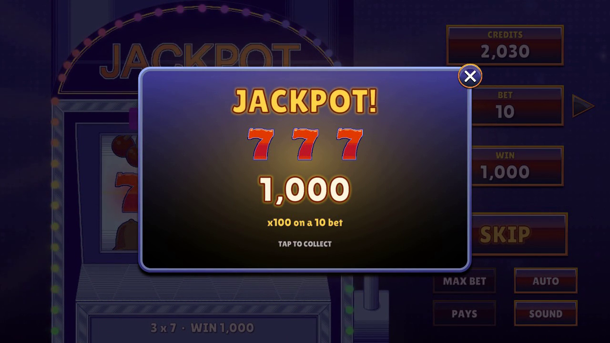
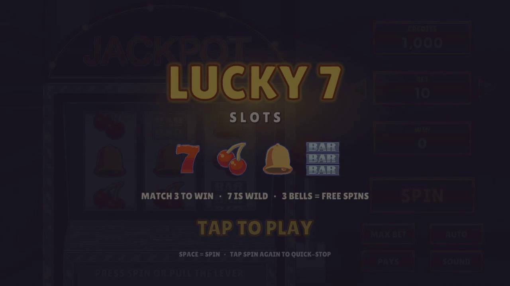
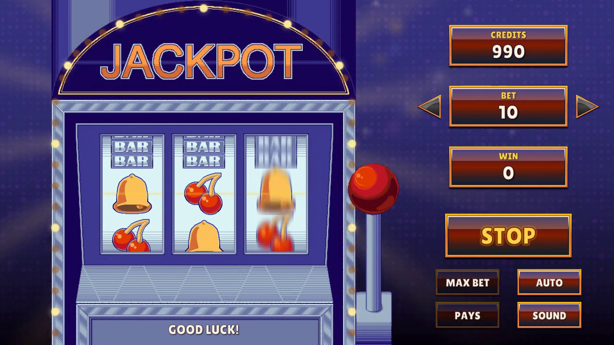
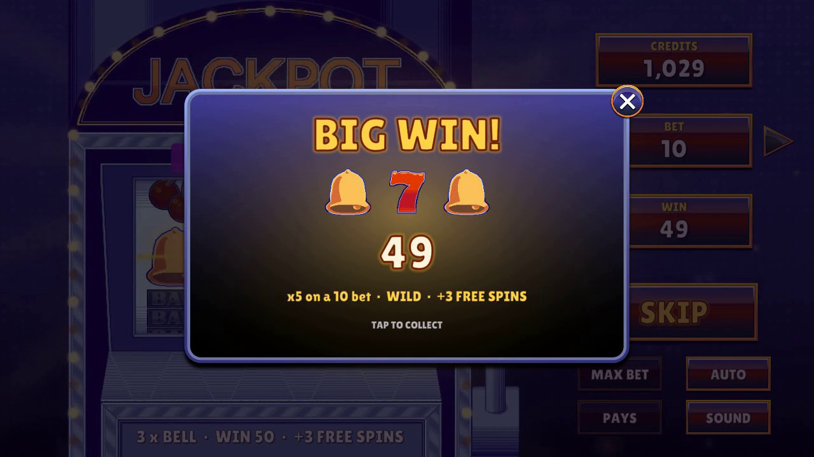
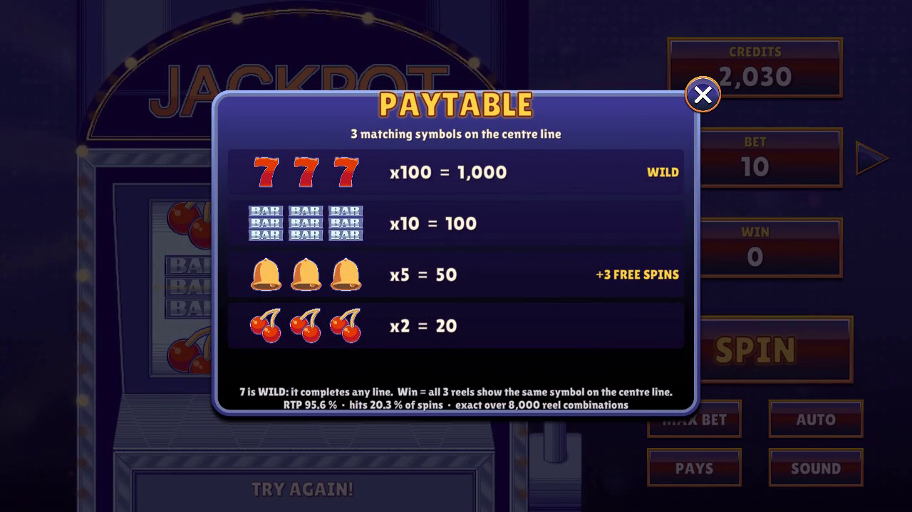

# 🎰 Lucky 7 Slots: Unity Slot Machine

A polished, fully playable 3-reel slot machine built in **Unity 2022.3 LTS**, using the provided art.
It runs in the browser as a **WebGL build** (`/Build/WebGL`).



**Play it now:** https://praneeth-slots.sites.tab.bot/ (the same WebGL build that is in this repo)

---

## Game Overview

- **3 reels, 1 centre pay line.** The player **wins when all three reels show the same symbol** on the centre line.
- **Symbols and paytable** (multiplier × bet):

  | Line | Pays | Notes |
  |---|---|---|
  | 7 · 7 · 7 | **x100** | **JACKPOT.** 7 is **WILD**: it substitutes for any symbol |
  | BAR · BAR · BAR | x10 | MEGA WIN |
  | BELL · BELL · BELL | x5 | BIG WIN + **3 FREE SPINS** |
  | CHERRY · CHERRY · CHERRY | x2 | WIN |

- **Credits system:** start with 1,000 credits. Each spin debits the bet; wins are paid after the reels stop, with an animated coin counter.
  If credits run out, a dialog offers a refill.
- **Bet selector:** 10 / 20 / 50 / 100 with arrow buttons, plus **MAX BET** (the largest bet the balance covers). The bet is locked while reels spin and during free spins.
- **Fair, unpredictable RNG:** outcomes come from `System.Security.Cryptography.RandomNumberGenerator`, using rejection sampling (no modulo bias), behind an injectable `IRandomProvider`.
- **Maths:** reel strips of 20 stops. The exact **RTP is 95.6%** and the **hit rate is 20.3%**, computed by enumerating all 8,000 stop combinations (`PayTableMath`). They are shown in the paytable and in the editor's RTP window.

## Instructions to run the WebGL build

**Option 1, online:** open https://praneeth-slots.sites.tab.bot/ (desktop or phone; landscape is best).

**Option 2, locally from this repo.** Browsers block WebGL builds opened from `file://`, so serve the folder over HTTP:

```bash
git clone https://github.com/Praneethrayalu/Unity-Slot-Machine.git
cd Unity-Slot-Machine/Build/WebGL
python -m http.server 8000        # or: npx serve .
# then open http://localhost:8000
```

The build is Brotli-compressed with *decompression fallback* (about 5 MB to download), so it runs on any static host (GitHub Pages, Netlify, itch.io) without special server headers.

**Controls:** SPIN button, the **lever**, or **Space** to spin. Press SPIN or Space again while the reels move to **quick-stop**. Use the arrows or MAX BET to change the bet. AUTO plays 25 spins. PAYS opens the paytable. SOUND toggles mute.

**Open the project in Unity:** Unity **2022.3 LTS** → open the project folder → `Assets/Scenes/SlotMachine.unity` → Play.
- Rebuild the WebGL player: menu **Slot Game ▸ Build WebGL**, or from the command line:
  `Unity -batchmode -quit -projectPath . -buildTarget WebGL -executeMethod SlotGame.Editor.BuildScript.BuildWebGL`
- Run the tests: **Window ▸ General ▸ Test Runner ▸ EditMode ▸ Run All** (45 tests).

## Bonus Features

| Feature | Details |
|---|---|
| 🃏 **Wild symbol** | 7 substitutes for any symbol. Three 7s is the jackpot. |
| 🔔 **Free spins** | Three bells award 3 free spins. They play automatically with the bet locked, and a banner counts them down. |
| 🎯 **Near-miss anticipation** | When the first two reels can still make a win, the last reel spins longer and slower, with a glowing frame, a suspense loop and a "SO CLOSE..." message. |
| 🏆 **Win tiers** | WIN banner → **BIG WIN** → **MEGA WIN** → **JACKPOT** popups with slam-in titles, coin fountain, count-up, sparkles and screen shake. |
| 💡 **Marquee lights** | Chasing bulbs around the cabinet: an attract chase when idle, a fast chase while spinning, flashing on wins and a rainbow sweep on the jackpot. |
| 🌌 **Living background** | Rotating light rays and drifting bokeh orbs. They speed up with the reels and flare on wins. |
| 🔁 **Auto-spin** | 25 spins in a row. Stops when credits run out or when tapped again. |
| ⚡ **Quick-stop** | Tap during a spin to slam the reels to a stop (the result is already decided, so it is fair). |
| 🕹️ **Lever** | Pull the cabinet's lever to spin (animated with the provided lever-up/down art). |
| 🔊 **Sound** | 12 synthesized effects: lever, spin loop, reel stops, anticipation, win jingles, coin ticks. Mute is saved between sessions. |
| 🎬 **Intro screen** | A title card that also unlocks browser audio with the first tap (browsers block sound until a user gesture). |
| ✨ **Juicy UI** | Springy buttons, an animated credits/win counter, a pulsing SPIN button and an animated paytable. |
| 🧪 **QA replay build** | A separate QA build accepts `?seed=123` to replay an exact outcome sequence. The release build compiles this out, so players cannot choose outcomes. |
| 📈 **RTP simulator** | An editor window (**Slot Game ▸ RTP Simulator**) runs millions of spins and compares them to the exact RTP. |

## Thought Process / Approach

**1. Separate the maths from the presentation.** The rules live in a plain C# assembly (`SlotGame.Core`) with **no UnityEngine dependency**: RNG, reel strips, win evaluation, wallet, bets and `SlotEngine`. This makes the game logic deterministic, fast to unit test, and impossible for animation code to influence.

**2. Decide first, animate second.** When the player spins, `SlotEngine.TryBeginSpin` debits the bet and draws the final stop of every reel from the RNG **before anything moves**. The reels are then told where to land. Animation timing, quick-stops and frame rate can never change an outcome, and this is how real slot machines work.

**3. Fair RNG.** `CryptoRandomProvider` wraps `RandomNumberGenerator` and uses **rejection sampling**, so `Next(n)` is exactly uniform. `SeededRandomProvider` (xorshift128+) implements the same `IRandomProvider` interface. It makes unit tests and QA replays reproducible, and it is only reachable in editor/QA builds.

**4. Data-driven design.** Symbols (`SymbolDefinition`, `SymbolDatabase`), the `PayTable`, the `ReelStripSet`, the machine `SlotMachineConfig` and the `ReelMotionProfile` are **ScriptableObjects**. A designer can retune pays, strips, bets, timings and easing without touching code, and the paytable UI and RTP update automatically.

**5. Reel motion that feels physical.** Each `Reel` goes through these phases: a small **wind-up** (pull back) → **ease-in acceleration** → constant spin with **motion-blurred** symbol sprites and vertical stretch → a **cubic deceleration** that lands exactly on the chosen stop → an **OutBack bounce**. The stops are **staggered** left to right. Only 5 symbol cells are recycled per reel (object pooling), and landing positions are computed from phase time, so a frame hitch can't make a reel overshoot.

**6. Event-driven architecture.** `SlotMachineController` orchestrates the spin and raises **C# events** (`SpinStarted`, `ReelStopped`, `AnticipationStarted`, `SpinCompleted`, `FreeSpinsChanged`, ...) and **UnityEvents** for designers. `UIManager`, `SlotAudioPresenter`, `MachineLights`, `MarqueeLights`, `ScreenShake`, `SparkleBurst`, `BackgroundFx` and `WinBanner` only *listen*. Each one has a single responsibility, and none knows about the others.

**7. Reproducible, tool-built content.** `SlotProjectBuilder` (menu **Slot Game ▸ Rebuild Project Assets**) generates sprite import settings, the font, data assets, animator controllers, prefabs and the scene from code. The project can be rebuilt from scratch in batch mode, which is also how the WebGL build was produced, and the builder verifies its own wiring (for example, that every label uses the game font).

**8. Tested.** 45 EditMode tests (Unity Test Framework) cover:
- the win evaluator (every symbol, wild substitution, near-miss detection);
- RNG distribution (chi-square uniformity, range limits, seeded reproducibility);
- the paytable maths;
- the wallet and bets (including MAX BET);
- the engine flow (debit → settle, free spins, insufficient credits).

### Architecture

```
Assets/Scripts
├── Core/            (pure C#, no UnityEngine; unit tested)
│   ├── Random/      IRandomProvider, CryptoRandomProvider, SeededRandomProvider
│   ├── Rules/       IPayTable, WinEvaluator, WinResult, PayTableMath (exact RTP)
│   ├── Reels/       ReelSet
│   ├── Economy/     Wallet, BetSelector
│   └── Game/        SlotEngine, SpinResult, SpinRejection, SlotSimulator
├── Data/            ScriptableObjects: SymbolDefinition, SymbolDatabase, PayTable,
│                    ReelStripSet, SlotMachineConfig, ReelMotionProfile
├── Gameplay/        SlotMachineController, Reel, ReelSymbol, LeverController,
│                    MachineLights, MarqueeLights, ScreenShake, BackgroundFx
├── UI/              UIManager, AnimatedCounter, WinPopup, WinBanner, PaytablePanel,
│                    ConfirmDialog, IntroScreen, CoinBurst, SparkleBurst, ButtonPunch
├── Audio/           AudioManager, SlotAudioPresenter, SoundLibrary, SoundId
├── Utilities/       Easing, AppBootstrap
└── Editor/          SlotProjectBuilder, BuildScript, RtpSimulatorWindow, UiFactory
Assets/Tests/EditMode   WinEvaluator, RNG distribution, engine and economy tests
Assets/Prefabs  Assets/Animations  Assets/UI  Assets/Sounds  Assets/Art  Assets/Data  Assets/Scenes
Build/WebGL     the playable WebGL build
```

### Assignment checklist

- [x] Playable slot machine in Unity using the provided assets (machine layers, symbols, buttons, popup, background)
- [x] Win when all slots show the same symbol (plus a wild 7)
- [x] Smooth, realistic reel animation: acceleration, motion blur, staggered stops, ease-out bounce
- [x] Clean symbol display with consistent alignment and sizing (fixed cell grid, aspect-preserving icons)
- [x] Proper RNG: `RandomNumberGenerator` behind an injectable `IRandomProvider`, with a seeded provider for tests
- [x] Clear win conditions and a payout simulation: credits, bet selector, per-symbol paytable
- [x] Bonus features: wild, free spins, auto-spin, near-miss, win celebrations, sounds and more
- [x] OOP design, meaningful names, C# conventions, critical logic commented
- [x] Folders: `Assets/Scripts`, `Assets/Prefabs`, `Assets/Animations`, `Assets/UI`, `Assets/Sounds`, `Assets/Art`
- [x] WebGL build in `/Build/WebGL`
- [x] README: overview, how to run, bonus features, approach
- [x] Step-by-step commit history

## Screenshots

| | |
|---|---|
|  |  |
|  |  |

## Credits

- Art: provided with the assignment (`Slot_Machine.zip`).
- Font: [Lilita One](https://fonts.google.com/specimen/Lilita+One) (SIL Open Font License, included).
- Sound effects: synthesized for this project.
